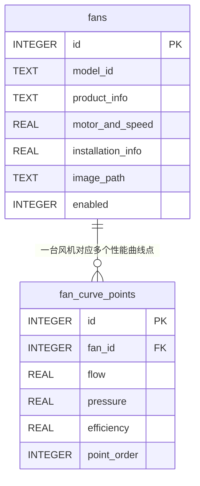

# 风机数据库大体结构

数据库文件：`fans.db`

## 结构关系图

## 1. `fans`：风机基本信息表

一台风机对应一条记录，主要保存：

- 风机型号与系列
- 制造厂家
- 产品名称与产品规格
- 风机类型
- 电动机型号
- 单台电机功率与电机数量
- 额定转速、最低转速和最高转速
- 扇叶角度
- 抽出式轨道宽度
- 风机图片路径
- 出厂编号
- 是否启用
- 创建时间与更新时间

该表用于保存风机的产品档案和选型所需的基础参数。

## 2. `fan_curve_points`：风机性能曲线点表

一台风机可以对应多个性能曲线点，主要保存：

- 所属风机编号
- 风量
- 风压
- 风机效率
- 曲线点排列顺序

该表用于绘制风机特性曲线，并求解风机曲线与管网曲线的交点。

## 数据关系说明

- `fans` 是主表。
- `fan_curve_points` 是从表。
- 两张表通过 `fans.id = fan_curve_points.fan_id` 关联。
- 删除一台风机时，可以同时删除它对应的全部性能曲线点。
- 屏蔽风机时只需将 `enabled` 设置为 `0`，不需要删除数据。

